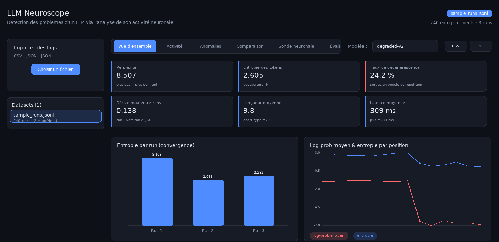
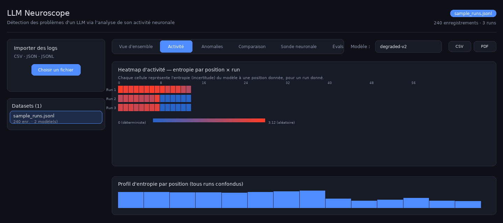
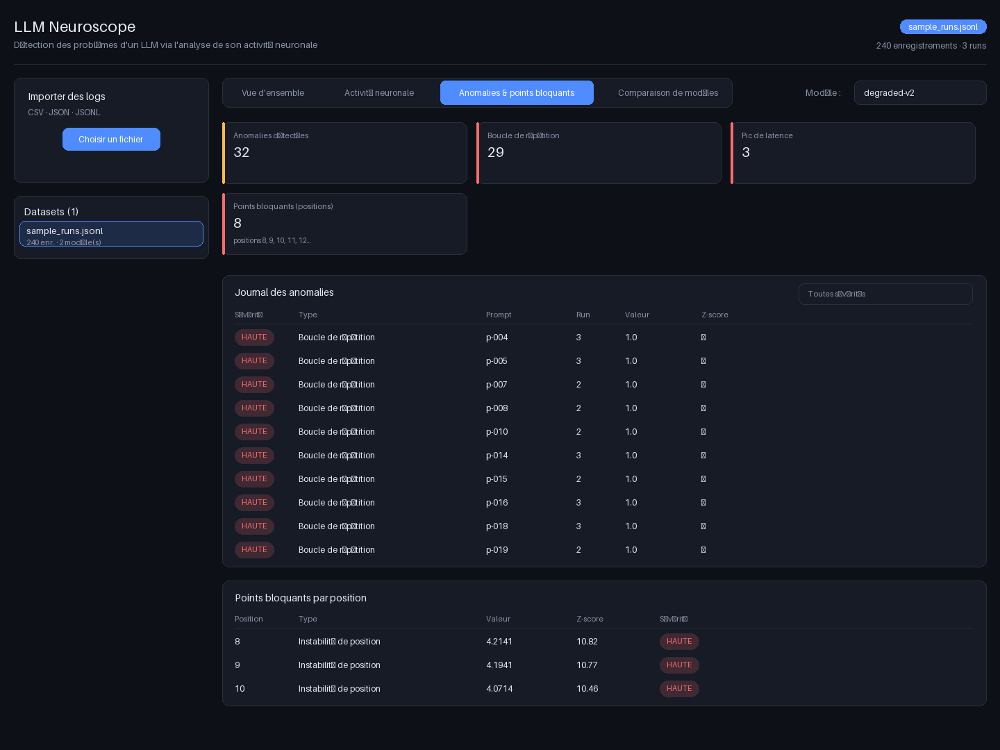
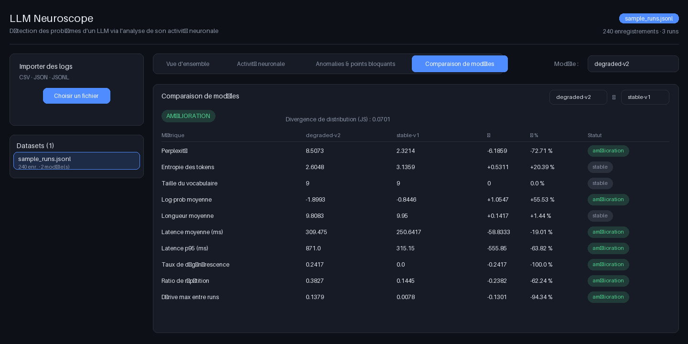
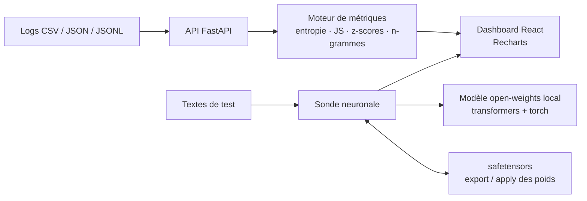

<div align="center">

# 🔬 LLM Neuroscope

**Détecter les problèmes d'un LLM en observant son activité neuronale — et intervenir dessus.**

Convergence · Dérive · Anomalies · Points bloquants · Poids & activations


</div>

---

## 📸 Aperçu

| Vue d'ensemble | Activité neuronale |
|:---:|:---:|
|  |  |
| **Anomalies & points bloquants** | **Comparaison de modèles** |
|  |  |

## ✨ Fonctionnalités

### 📊 Analyse statistique de logs (CSV / JSON / JSONL)

| Capacité | Détail |
|---|---|
| **Ingestion universelle** | Détection automatique des colonnes et alias (`model`, `tokens`, `logprobs`, `run`…) |
| **Convergence** | Entropie par run, dérive inter-runs (divergence de Jensen-Shannon) |
| **Santé du modèle** | Perplexité, entropie des tokens, vocabulaire, longueur, latence (p95) |
| **Dégénérescence** | Détection des boucles de répétition par n-grammes |
| **Points bloquants** | Effondrement de logprobs, instabilité de position, pics d'entropie — par position |
| **Anomalies** | Z-scores + sévérité (haute / moyenne / basse) sur logprobs, longueurs, latences |
| **Comparaison de versions** | Deltas métrique par métrique + verdict automatique (stable / vigilance / régression / amélioration) |

### 🧠 Sonde neuronale (modèles open-weights locaux)

| Capacité | Endpoint |
|---|---|
| Charger un modèle local | `POST /api/probe/load` |
| Tester avec des textes → activité par couche (neurones morts, top neurones) | `POST /api/probe/analyze-texts` |
| Inspecter les poids (stats, histogramme, poids morts) | `GET /api/probe/weights/{layer}` |
| Modifier un neurone (×facteur, mise à zéro) — **réversible** | `POST /api/probe/weights/modify` |
| Exporter / réappliquer les modifications | `POST /api/probe/weights/export` · `POST /api/probe/weights/apply` |
| **Entropie d'attention** par couche × tête (TransformerLens) | `POST /api/probe/attention` |
| Génération instrumentée (tokens + logprobs + perplexité) | `POST /api/probe/generate` |

> ⚠️ **Important** : les poids et activations ne sont accessibles que pour un modèle
> open-weights exécuté localement (GPT-2, Pythia, TinyLlama, Mistral-7B…). Les APIs
> fermées (Mistral API, OpenAI…) n'exposent ni poids ni activations — pour elles,
> seule l'analyse de logs s'applique.

## 🏗️ Architecture



```
backend/              API FastAPI
├── app/services/     ingestion · metrics · comparison · probe (mock + torch)
├── app/routers/      datasets · analysis · probe
└── tests/            31 tests pytest
frontend/             Dashboard React + Vite + Recharts (5 onglets)
scripts/              generate_sample_data.py · render_ui_previews.py
data/                 sample_runs.jsonl · weight-edits/ (exports safetensors)
docs/                 agent-api.md (pilotage par IA) · screenshots/
```

## 🚀 Démarrage rapide

```bash
# Backend
cd backend
pip install -r requirements.txt
uvicorn app.main:app --reload --port 8000

# Frontend (autre terminal)
cd frontend
npm install
npm run dev        # → http://localhost:3000

# Dataset de démonstration (2 modèles : un sain, un dégradé)
python scripts/generate_sample_data.py
```

Pour la sonde neuronale avec un vrai modèle :

```bash
pip install -r backend/requirements-probe.txt   # torch + transformers + safetensors
# puis onglet « Neurones & poids » → charger gpt2, EleutherAI/pythia-70m…
```

## 🤖 Pilotage par une autre IA

LLM Neuroscope est conçu pour être **piloté par un agent** : toutes les fonctions
sont des endpoints JSON documentés dans **[docs/agent-api.md](docs/agent-api.md)**
(session type : charger → tester avec textes → lire les poids → modifier →
mesurer → restaurer, avec bonnes pratiques).

## 🧪 Tests

```bash
cd backend && python -m pytest tests -q    # 31 tests
cd frontend && npm run build               # build Vite
python scripts/render_ui_previews.py       # aperçus PNG depuis l'API réelle
```

Validé en conditions réelles : `hf-internal-testing/tiny-random-gpt2` (~5 Mo) et
`EleutherAI/pythia-70m` (entraîné) — modification d'un neurone → effet mesuré sur
la génération → restauration bit-à-bit.

## 🧩 Écosystème & intégrations candidates

Veille sur l'écosystème open source — bibliothèques repérées pour enrichir l'outil :

| Bibliothèque | Ce qu'elle apporterait | Priorité |
|---|---|---|
| [safetensors](https://github.com/huggingface/safetensors) (Hugging Face) | ✅ **Intégré** — export/import des poids modifiés, format sûr et standard | fait |
| [TransformerLens](https://github.com/TransformerLensOrg/TransformerLens) | ✅ **Intégré** — entropie d'attention par couche × tête via `TransformerBridge` | fait |
| [nnsight](https://github.com/nnsight/nnsight) | Intervention dans les internals de modèles géants (tracer, éditer les activations à la volée) | haute |
| Activation patching via TransformerLens | Comparer les activations avant/après modification de poids, position par position | haute |
| [Captum](https://github.com/pytorch/captum) / [SHAP](https://github.com/shap/shap) | Attribution d'importance par token / neurone | moyenne |
| [DeepEval](https://github.com/confident-ai/deepeval) | Évals de qualité (G-Eval, hallucination, pertinence) complémentaires des métriques internes | moyenne |
| [Langfuse](https://github.com/langfuse/langfuse) | Observabilité des traces en production à connecter aux analyses hors-ligne | moyenne |
| [lm-evaluation-harness](https://github.com/EleutherAI/lm-evaluation-harness) | Benchmarks standardisés comparables entre versions | basse |

## 🗺️ Feuille de route

- [x] Entropie d'attention par couche × tête (via TransformerLens)
- [ ] Activation patching avant/après modification automatisé
- [ ] Export PDF/CSV des rapports d'analyse
- [ ] Seuils d'alerte configurables par modèle
- [ ] Support GGUF / llama.cpp pour les modèles quantisés
- [ ] Mode multi-modèles (>2) dans la comparaison

---

<div align="center">
<sub>Construit avec FastAPI · React · Recharts · safetensors — les experts : 1 architecte ML, 1 dev backend, 1 dev frontend 🤖</sub>
</div>
